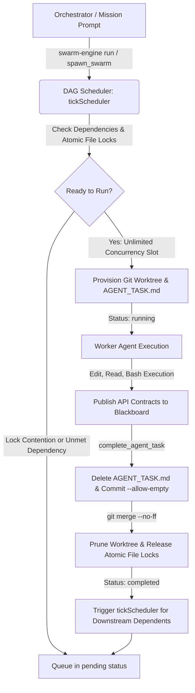

<div align="center">

# ⚡ Swarm Engine

### Autonomous Multi-Agent Orchestration Engine & Universal Agent Skill
**Infinite Parallel Concurrency · Zero Git Collisions · Live Fable TUI Telemetry · Auto Model Discovery**

[](LICENSE)
[](test/)
[](test/verify_packaging_and_scaling.mjs)
[](https://www.typescriptlang.org/)
[](https://nodejs.org)
[](https://modelcontextprotocol.io)
[](package.json)
[](#-infinite-concurrency--arbitrary-scaling)

<p align="center">
  <b>Swarm Engine</b> transforms any single AI coding assistant or human developer into an autonomous multi-agent engineering team. It provisions isolated Git worktrees, eliminates merge collisions via atomic file locking, coordinates inter-agent contracts via a live blackboard bus, streams real-time telemetry to an interactive <b>Fable 5.1 terminal dashboard</b>, and scales across <b>5 to 20+ specialized subagents</b> running in true parallel with <b>infinite concurrency</b>.
</p>

[Quick Start](#-quick-start) • [Live Dashboard](#%EF%B8%8F-live-fable-dashboard-preview) • [Agent Skill (No MCP Needed)](#-universal-agent-skill-zero-mcp-required) • [CLI Reference](#-complete-cli-reference) • [Architecture](#-architecture--lifecycle) • [Safeguards](#-the-4-operational-safeguards)

</div>

---

## 🌟 Why Swarm Engine?

| Feature | What It Does | Why It Matters |
|:---|:---|:---|
| **⚡ Infinite Concurrency ($\infty$)** | Default `maxConcurrency: 0` removes artificial worker caps. All non-conflicting agents execute in parallel immediately. | Zero queuing or bottlenecks. Refactor 15 modules in parallel instead of one by one. |
| **🛡️ Zero Git Collisions** | Each subagent operates inside an isolated Git worktree (`.swarm/worktrees/<agentId>`) on an independent branch. | No overwriting files, no mid-run conflicts, and zero risk of corrupting your working directory. |
| **🤖 Auto Model Detection** | Dynamically discovers your active client model from Kilo (`MiniMax-M2.7`), Claude Code, Cursor, `.env`, or Ollama. | Zero hardcoded models. Subagents always match the developer's chosen model and provider. |
| **🎯 Universal Agent Skill** | Pre-packaged and synchronized across 7 host ecosystems (Kilo, Claude, Cursor, Antigravity, Cline, Roo, Continue). | **Skip MCP configuration files entirely.** AI assistants invoke Swarm Engine natively via the CLI. |
| **🎨 Fable 5.1 Terminal TUI** | Real-time visual terminal dashboard with 2-column cards, diff bars, tool dispatches, and token speeds (`tok/s`). | Full visibility into what every background agent is reading, editing, or testing in real time. |
| **🧠 Shared Blackboard Bus** | Key-value store for passing API contracts, schemas, and architecture decisions between sibling agents. | Downstream agents read upstream contracts instantly without cross-branch polling. |
| **🔒 Atomic File Mutual Exclusion** | Directory-level file locks (`state.json.lock`) with automatic stale lock recovery (>30s or dead PID). | Prevents multiple agents from editing the same file concurrently while unblocking others. |
| **🚀 Zero-Bloat Architecture** | Powered strictly by `@modelcontextprotocol/sdk` and `zod`, using native Node.js primitives for crypto and FS. | Lightweight, blazing fast start-up, and zero unnecessary runtime dependencies. |

---

## 🖥️ Live Fable Dashboard Preview

When you run `swarm-engine run` or `swarm-engine watch`, Swarm Engine renders an interactive terminal dashboard styled after the Fable 5.1 visual system:

```text
swarm-engine -> 3 × workers · ~/my-app                                            ↓ 242.0k · 12m 45s
* swarm   lead orchestrator                                                workers : gpt-4o : claude-3-5
● Final pass. Dispatching.
● Mission: Multi-agent service refactoring and API migration
● @worker-1 Fix lint errors and refactor codebase.
◒ Orchestrating... (12m 45s · 242.0k tokens · esc to interrupt)
────────────────────────────────────────────────────────────────────────────────────────────────────────
╭ * worker-1 ──────────────── refactor_specialist · gpt-4o ╮ ╭ * worker-2 ─────────────────── test_engineer ╮
│ ● Edit(src/services/auth.ts)                             │ │ ● Read(tests/auth.test.ts)                   │
│  140 - let reps = 0                                      │ │   └ Read 94 lines                            │
│   68 + const reps = 0                                    │ │ ● Bash(npm test auth)                        │
│ ● Refactoring... (↓ 92.0k · 78 tok/s)                    │ │ ● Testing... (↓ 124.0k · 110 tok/s)          │
╰──────────────────────────────────────────────────────────╯ ╰──────────────────────────────────────────────╯
╭ * worker-3 ────────────────────────────── cleanup_agent ╮
│ ● Read(src/ui/Component.tsx)                             │
│   └ Read 160 lines                                       │
│ ● Simmering... (↓ 26.0k · 44 tok/s)                      │
╰──────────────────────────────────────────────────────────╯
[swarm-engine] 0:agents* 1:orchestrator ● 1/3 done · +142 -38 lines · 1 active lock       q: quit  r: refresh
```

---

## 🚀 Quick Start

### 1. Global Installation (Recommended)

Install globally using `npm` to make the `swarm-engine` command available anywhere in your terminal:

```bash
npm install -g swarm-engine
```

Or link from local source:

```bash
git clone https://github.com/PRIYAGDEV/swarm-engine.git
cd Swarm-engine
npm install
npm run build
npm link
```

### 2. Launch Your First Swarm in 30 Seconds

```bash
# 1. Initialize swarm in your repository with infinite concurrency
swarm-engine init "Refactor payment service and build comprehensive integration tests" --concurrency 0

# 2. Launch autonomous execution with live Fable cards (auto-detects your active model)
swarm-engine run "Refactor payment service and build comprehensive integration tests" --workers 8

# 3. In another terminal, open the live auto-refreshing dashboard
swarm-engine watch

# 4. Check status as plain table (CI mode) or machine-readable JSON
swarm-engine status --table
swarm-engine status --json

# 5. Cleanly reset when finished (prunes worktrees and temporary branches)
swarm-engine reset --hard
```

---

## 👥 Infinite Concurrency & Arbitrary Scaling

Swarm Engine eliminates artificial worker bottlenecks:
- **`maxConcurrency: 0` (Default)**: Concurrency is **infinite ($\infty$)**. Any number of subagents without dependency or file lock conflicts run concurrently at the same time.
- **Parallel Dispatch (`parallel: true`)**: Tasks are scheduled concurrently across isolated worktrees. No agent waits in queue unless an explicit dependency (`dependsOn`) or file lock collision requires it.
- **Arbitrary Subagent Count**: Spawn **5 to 20+ specialized subagents** per mission.

### Recommended 5–20+ Subagent Archetypes

When decomposing complex missions, partition tasks by architectural boundary and non-overlapping `targetFiles`:

| Specialist Agent | Core Responsibility | Typical Target Files |
|:---|:---|:---|
| **`system_architect`** | Defines root interfaces, type contracts, and blackboard schemas | `src/types/**`, `src/interfaces/**` |
| **`db_schema_engineer`** | Database migrations, ORM entities, and schema indexing | `src/db/schema.ts`, `migrations/**` |
| **`api_route_builder`** | REST / RPC endpoints, controllers, and input validation | `src/api/routes/**`, `src/controllers/**` |
| **`auth_security_guard`** | Authentication middleware, JWT/OAuth tokens, and RBAC guards | `src/auth/**`, `src/middleware/auth.ts` |
| **`domain_logic_dev`** | Core business services, state machines, and calculations | `src/services/**`, `src/domain/**` |
| **`frontend_ui_builder`** | Visual components, layout structures, and design tokens | `src/components/**`, `src/views/**` |
| **`state_manager`** | Reactive store slices, context providers, and action dispatchers| `src/store/**`, `src/context/**` |
| **`api_client_engineer`** | Frontend data-fetching hooks, mutation queries, and client SDK | `src/api/client.ts`, `src/hooks/**` |
| **`unit_test_writer`** | Comprehensive unit test suites and mocked assertions | `test/unit/**`, `src/**/*.spec.ts` |
| **`integration_tester`** | Multi-service API and database integration tests | `test/integration/**`, `test/api/**` |
| **`e2e_qa_engineer`** | End-to-end user journeys and scenario verification | `test/e2e/**`, `e2e/**` |
| **`security_auditor`** | Vulnerability scanning, injection checks, and secret safety | `audit/security.md`, `src/guards/**` |
| **`perf_optimizer`** | Memory profiling, database index tuning, and bundle reduction | `src/bench/**`, `src/utils/perf.ts` |
| **`docs_technical_writer`**| OpenAPI specs, developer guides, and architecture docs | `docs/**`, `README.md`, `openapi.yaml`|

---

## 🧠 Universal Agent Skill (Zero MCP Required!)

> **Skip MCP Configuration!** You do not need to configure stdio MCP servers or debug JSON-RPC connections. Swarm Engine is pre-packaged as a first-class **Agent Skill** ([`skills/swarm-engine/SKILL.md`](skills/swarm-engine/SKILL.md)).

AI coding assistants (**Kilo Code**, **Claude Code**, **Cursor**, **Antigravity**, **Cline**, **Roo Code**, **Continue**) interact with Swarm Engine directly through standard shell commands.

### Synchronized Environments

The Swarm Engine skill is automatically verified and synchronized across 7 host locations:

```text
📁 Canonical Skill:  skills/swarm-engine/SKILL.md
├── 1. Antigravity:  ~/.gemini/config/skills/swarm-engine/
├── 2. Kilo CLI:     ~/.config/kilo/skills/swarm-engine/
├── 3. Claude Code:  ~/.claude/skills/swarm-engine/
├── 4. Cursor:       ~/.cursor/skills/swarm-engine/
├── 5. Cline:        ~/.cline/skills/swarm-engine/
├── 6. Roo Code:     ~/.roo/skills/swarm-engine/
└── 7. Continue:     ~/.continue/skills/swarm-engine/
```

To re-sync and audit all skill locations on your PC at any time, run:

```bash
npm run sync:skills
```

### Automatic Model Discovery

Swarm Engine detects what model you are currently using without hardcoded fallbacks:
1. Inspects active Kilo configuration (`~/.config/kilo/kilo.jsonc` $\to$ e.g. `MiniMax-M2.7`, `GLM-5.3-Flash`, `DeepSeek-V4`).
2. Checks workspace `.env` for `ANTHROPIC_MODEL`, `OPENAI_MODEL`, or `GEMINI_MODEL`.
3. Inspects Claude Code, Cursor, and Ollama endpoints.
4. Dynamically assigns your active model to all spawned subagents.

---

## 📖 Complete CLI Reference

```bash
swarm-engine <subcommand> [arguments] [options]
```

| Subcommand | Aliases | Description | Key Flags |
|:---|:---|:---|:---|
| `init [mission]` | | Initializes `.swarm/`, creates `AGENTS.md`, and updates `.gitignore` | `--concurrency <num>` (default: `0` / $\infty$), `--worker <cmd>`, `-f` |
| `run [mission]` | `start` | Launches autonomous multi-agent execution with live Fable dashboard | `--workers <num>`, `--concurrency <num>`, `--model <name>`, `-f` |
| `watch` | `dashboard`, `tui` | Opens real-time interactive Fable TUI dashboard in any terminal | `--interval <ms>` (default: 2000), `--once` |
| `status` | | Displays real-time mission state, active file locks, and agent telemetry | `--table` (CI plain text), `--json` (machine output) |
| `worker <agentId>` | | Executes background worker loop within the agent's worktree sandbox | `--cwd <path>` |
| `complete <agentId>`| | Deletes `AGENT_TASK.md`, commits changes, and merges cleanly via `--no-ff` | `[summary]` |
| `reset` | | Prunes all git worktrees, deletes temporary branches, and cleans locks | `--hard`, `--keep-blackboard` |
| `mcp` | | Runs the Model Context Protocol stdio JSON-RPC server (optional) | N/A |

---

## 🔌 Optional: MCP Server Configuration

If you prefer using Swarm Engine as an MCP server, it exposes **9 standard tools** over stdio JSON-RPC:

<details>
<summary><b>Click to expand MCP Client Configuration (Kilo, Cursor, Claude Desktop, Cline)</b></summary>

### 1. Kilo Code, Cline & Roo Code
Add to `cline_mcp_settings.json`:
```json
{
  "mcpServers": {
    "swarm-engine": {
      "command": "swarm-engine",
      "args": ["mcp"]
    }
  }
}
```

### 2. Cursor
Add to `.cursor/mcp.json`:
```json
{
  "mcpServers": {
    "swarm-engine": {
      "command": "swarm-engine",
      "args": ["mcp"]
    }
  }
}
```

### 3. Claude Desktop
Add to `claude_desktop_config.json`:
```json
{
  "mcpServers": {
    "swarm-engine": {
      "command": "swarm-engine",
      "args": ["mcp"]
    }
  }
}
```

### MCP Tools List

| Tool Name | Purpose | Key Parameters |
|:---|:---|:---|
| `spawn_swarm` | Initializes mission with arbitrary parallel subagents | `mission`, `maxConcurrency`, `agents`, `workerCommand` |
| `add_dynamic_agent` | Adds specialist agent mid-run; schedules dynamically | `role`, `taskSpec`, `model`, `dependsOn`, `targetFiles` |
| `pull_agent_task` | Claims next ready task with blackboard memory | `agentId` (optional) |
| `record_agent_action`| Streams live actions (`Edit`, `Read`, `Bash`) and diffs | `agentId`, `actionType`, `target`, `diffs`, `detail` |
| `update_agent_progress`| Updates thoughts, poetic verbs, tokens, and `tok/s` | `agentId`, `thought`, `verb`, `tokens`, `tokPerSec` |
| `run_agent_task` | Triggers background worker execution in worktree | `agentId` |
| `write_blackboard` | Publishes shared schemas or API contracts | `key`, `value` |
| `complete_agent_task` | Commits changes and merges to main cleanly (`--no-ff`)| `agentId`, `summary` |
| `get_swarm_status` | Returns complete real-time JSON and visual card snapshot| `detail` (boolean) |

</details>

---

## 🔄 Architecture & Lifecycle

Swarm Engine coordinates multi-agent workflows through a deterministic, fail-safe lifecycle:



1. **Mission Decomposition**: The mission is partitioned into specialized roles with assigned `targetFiles`.
2. **DAG Scheduling**: Concurrency defaults to infinite (`0`). Every agent without an active file lock conflict or unmet `dependsOn` begins execution immediately.
3. **Worktree Provisioning**: Each agent receives an isolated Git worktree (`.swarm/worktrees/<agentId>`) on an independent branch (`swarm/<agentId>`), populated with `AGENT_TASK.md`.
4. **Live Telemetry & Diff Streaming**: Worker actions (`Edit`, `Read`, `Bash`), poetic verbs, token counts, and diff bars are streamed in real time to the Fable dashboard.
5. **Contract Propagation**: Shared data structures, interfaces, and migration scripts are written to the in-memory blackboard bus.
6. **Zero-Pollution Merge**: `AGENT_TASK.md` is removed before commit, ensuring prompt files never enter git history. Changes are merged into `main` cleanly with `--no-ff`.

---

## 🛡️ The 4 Operational Safeguards

Swarm Engine enforces four non-negotiable safeguards to guarantee workspace safety:

```text
┌────────────────────────────────────────────────────────────────────────┐
│                      SWARM ENGINE SAFETY SHIELD                        │
├────────────────────┬───────────────────────────────────────────────────┤
│ S1: Stdio Protocol │ Stdout strictly reserved for JSON-RPC in MCP mode. │
│     Isolation      │ All diagnostics route strictly to stderr.         │
├────────────────────┼───────────────────────────────────────────────────┤
│ S2: Clean Git History│ AGENT_TASK.md deleted before commit.              │
│     & Merge Safety │ Empty diffs handled cleanly via --allow-empty.    │
├────────────────────┼───────────────────────────────────────────────────┤
│ S3: Non-Git & Zero-│ Automatic fallback to atomic directory snapshotting│
│     Commit Fallback│ when run outside git or in unborn repositories.   │
├────────────────────┼───────────────────────────────────────────────────┤
│ S4: Normalized File│ Paths normalized across Windows, macOS, and Linux │
│     Lock Paths     │ to prevent cross-platform lock collisions.        │
└────────────────────┴───────────────────────────────────────────────────┘
```

---

## 🧪 Comprehensive Verification & Test Suite

Swarm Engine is tested and verified against real Git operations, live MCP stdio transports, and high-concurrency multi-agent scenarios:

### 1. Automated Test Suite (59/59 Passing)

```bash
npm test
```

```text
▶ Tier 1 - MCP Tools in Isolation (7 tests)
▶ Tier 1 - CLI Subcommands in Isolation (5 tests)
▶ Tier 2 - Boundary & Corner Cases (8 tests)
▶ Tier 3 - Cross-Feature Interactions (7 tests)
▶ Tier 4 - Real-World Multi-Agent Workflows (3 tests)
▶ Tier 5 - Adversarial Coverage Hardening (16 tests)
▶ Tier 6 - Fable Multi-Agent Execution & Live Actions (6 tests)

ℹ tests 59 | pass 59 | fail 0 | cancelled 0 | skipped 0 (100% pass rate)
```

### 2. Multi-Environment Programmatic Verification (13/13 Checks)

```bash
npm run verify
```

```text
================================================================================
SWARM ENGINE PROGRAMMATIC VERIFICATION SUITE
================================================================================
--- PILLAR 1: Multi-Environment Skill Structure Verification ---
[STEP 1] Verify canonical repository skill (skills/swarm-engine)... ✓ PASS
[STEP 2] Verify synchronized target AI agent environments (7 hosts)... ✓ PASS

--- PILLAR 2: MCP Tool Schema & Arbitrary Scaling Verification ---
[STEP 3] Inspect MCP tools/list over stdio JSON-RPC... ✓ PASS
[STEP 4] Verify spawn_swarm unbounded schema & decomposition guidance... ✓ PASS
[STEP 5] Verify add_dynamic_agent on-the-fly scaling & parameter guidance... ✓ PASS

--- PILLAR 3: Live Dry-Run & Multi-Agent Execution (15-20+ Subagents) ---
[STEP 6] CLI init with --concurrency 0 creates .swarm and AGENTS.md... ✓ PASS
[STEP 7] CLI status --json confirms maxConcurrency === 0 (unlimited)... ✓ PASS
[STEP 8] MCP spawn_swarm with 15 specialized subagents: immediate parallel execution (0 queuing)... ✓ PASS
[STEP 9] Audit on-disk presence of 15 isolated worktrees, AGENT_TASK.md, and file locks... ✓ PASS
[STEP 10] Inject 3 dynamic agents via add_dynamic_agent (total 18 agents, zero queuing)... ✓ PASS
[STEP 11] Test shared blackboard write_blackboard and verify context propagation... ✓ PASS
[STEP 12] Execute complete_agent_task with file modification: assert --no-ff merge... ✓ PASS
[STEP 13] CLI reset --hard tears down all remaining worktrees and restores clean state... ✓ PASS

================================================================================
ALL VERIFICATION PILLARS PASSED SUCCESSFULLY! (13/13 checks in 18693ms)
================================================================================
```

---

## 📄 License

This project is open-source software licensed under the **[MIT License](LICENSE)**.

Made with ⚡ by **[PRIYAGDEV](https://github.com/PRIYAGDEV)**. Contributions, feedback, and feature requests are welcome!
