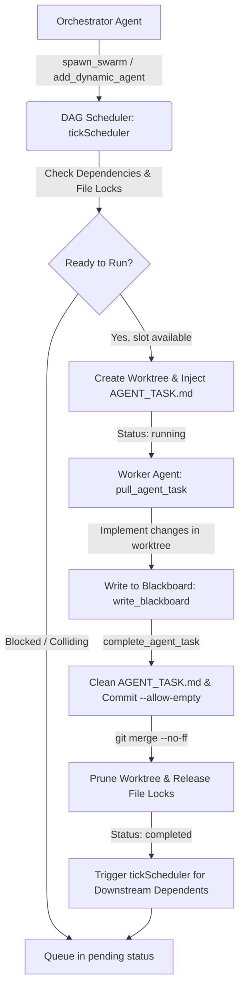

# Swarm Engine

[](LICENSE)
[](https://modelcontextprotocol.io)
[](https://nodejs.org)

**Swarm Engine** is a zero-bloat, production-ready CLI and Model Context Protocol (MCP) server that empowers single AI coding agents (Claude Code, Cline, Cursor, Roo Code, Kilo Code) and human engineers to dynamically coordinate, parallelize, and synchronize multi-agent programming swarms.

It provisions isolated Git worktrees (with automatic non-git fallback), enforces atomic filesystem-level file locking, schedules tasks through a Directed Acyclic Graph (DAG) with concurrency gating, provides shared blackboard memory for inter-agent communication, and cleanly synchronizes completed work back to the main repository.

---

## Key Capabilities

- **Dynamic Multi-Agent Spawning (1 to $N$)**: Spawn any number of specialized sub-agents with custom roles, system prompts, target file boundaries, and task specifications.
- **Git Worktree Isolation**: Run parallel agents in independent worktrees (`.swarm/worktrees/<agentId>`) on dedicated branches (`swarm/<agentId>`) to eliminate working-tree collisions.
- **Atomic Directory-Based Locking**: POSIX & Windows cross-platform mutual exclusion via `fs.mkdir` (`.swarm/state.lock`) with exponential backoff and automatic stale lock recovery (>30s or dead PID).
- **DAG Dependency Resolution**: Schedule execution graphs where downstream agents wait for prerequisite agents to reach `completed` status before activating.
- **Shared Blackboard Memory**: Real-time shared key-value memory for passing API contracts, database schemas, and configuration flags across agents.
- **Zero-Bloat Dependencies**: Powered exclusively by `@modelcontextprotocol/sdk` and `zod`, relying on Node.js native primitives for all subprocess, filesystem, and cryptography operations.

---

## The 4 Non-Negotiable Operational Safeguards

Swarm Engine strictly enforces four core operational safeguards across all modules:

| Safeguard | Name | Description & Enforcement |
|:---:|:---|:---|
| **S1** | **Protect Stdio in MCP** | In MCP mode (`swarm-engine mcp`), stdout is strictly reserved for newline-delimited JSON-RPC frames. Absolutely zero `console.log` calls exist in `src/state.ts`, `src/spawner.ts`, `src/mcp.ts`, or the MCP command path. All informational and debug logs are routed strictly to `console.error` (stderr) to prevent protocol framing corruption. |
| **S2** | **Clean Git Merges & .gitignore** | `swarm-engine init` automatically appends `.swarm/` and `AGENT_TASK.md` to `.gitignore`. During `mergeAndComplete()`, `AGENT_TASK.md` is deleted before running `git add -A` so task prompt files never pollute git history. Merges handle empty diffs cleanly using `--allow-empty` commits with default author identity (`Swarm Agent <swarm@local>`). |
| **S3** | **Non-Git Fallback in `mergeAndComplete` & `createWorktree`** | When operating outside a Git repository or in an unborn repo (0 commits / no HEAD), `createWorktree` automatically falls back to recursively copying workspace files (excluding `.git`, `node_modules`, `.swarm`) into `.swarm/worktrees/<agentId>`. Upon completion, `mergeAndComplete` automatically copies modified files back to the project root and cleans up the worktree. |
| **S4** | **Normalize File Lock Paths** | All file paths in `targetFiles` and `lockedFiles` are automatically normalized (leading `./` removed, backslashes `\` converted to forward slashes `/`, duplicate slashes collapsed). This prevents lock collision check mismatches across Windows and POSIX filesystems. |

---

## Installation & Quickstart

### 1. Installation

Install Swarm Engine globally to run the `swarm-engine` command anywhere:

```bash
# Install globally
npm install -g swarm-engine

# Or inside this repository (local development):
npm install
npm run build
npm link
```

### 2. Initializing & Running Missions

You can run Swarm Engine directly via CLI or `npx`:

```bash
# Initialize Swarm Engine in any project repository
swarm-engine init "Build and verify feature architecture" --concurrency 4

# Or launch autonomous execution with the live Fable TUI dashboard
swarm-engine run "Automated feature refactoring and test suite" --concurrency 4

# Run on-demand without prior global installation
npx swarm-engine init "Your mission description" --concurrency 4
```

### 3. Local Development from Source
```bash
# Clone the repository
git clone https://github.com/PRIYAGDEV/swarm-engine.git
cd Swarm-engine

# Install dependencies and build
npm install
npm run build

# Run tests (56 automated tests across 6 tiers)
npm test
```

---

## MCP Client Configuration

Connect your favorite AI coding assistant to Swarm Engine by adding the stdio server definition to your MCP configuration file.

### Claude Desktop
File: `claude_desktop_config.json`
- **macOS**: `~/Library/Application Support/Claude/claude_desktop_config.json`
- **Windows**: `%APPDATA%\Claude\claude_desktop_config.json`

```json
{
  "mcpServers": {
    "swarm-engine": {
      "command": "npx",
      "args": ["swarm-engine", "mcp"]
    }
  }
}
```

### Cursor
File: `.cursor/mcp.json` or Settings > Features > MCP

```json
{
  "mcpServers": {
    "swarm-engine": {
      "command": "npx",
      "args": ["swarm-engine", "mcp"]
    }
  }
}
```

### Cline & Roo Code
File: `cline_mcp_settings.json`

```json
{
  "mcpServers": {
    "swarm-engine": {
      "command": "npx",
      "args": ["swarm-engine", "mcp"]
    }
  }
}
```

### Local Development / Node Path
If running from source:
```json
{
  "mcpServers": {
    "swarm-engine": {
      "command": "node",
      "args": ["/absolute/path/to/Swarm-engine/dist/index.js", "mcp"]
    }
  }
}
```

---

## MCP Tools Reference

When connected via MCP, Swarm Engine exposes 9 core tools:

| Tool Name | Description | Key Arguments | Return Value |
|:---|:---|:---|:---|
| `spawn_swarm` | Initializes or reconfigures a multi-agent swarm mission, sets concurrency limit, and queues 1..N initial agents forming a DAG. Supports dynamic model targeting configured by user/client (e.g. via model parameter or environment variables). | `mission` (string)<br>`maxConcurrency` (number, opt)<br>`workerCommand` (string, opt)<br>`agents` (array of agent configs) | `{ success, mission, maxConcurrency, totalAgents, runningAgents, pendingAgents, activeLocks }` |
| `add_dynamic_agent` | Adds an on-the-fly specialist agent mid-flight during swarm execution, automatically validating dependencies and scheduling. | `role` (string)<br>`model` (string, opt)<br>`taskSpec` (string)<br>`systemPrompt` (string, opt)<br>`dependsOn` (string[], opt)<br>`targetFiles` (string[], opt) | `{ success, agent, scheduled, reason }` |
| `pull_agent_task` | Claims or inspects the next ready task (or a specific agent ID), returning the worktree path, task spec, system prompt, and blackboard memory. | `agentId` (string, opt) | `{ success, agentId, role, status, worktreePath, branchName, taskSpec, targetFiles, blackboard }` |
| `record_agent_action` | Records a live tool action (`Edit`, `Read`, `Bash`, `Update`) with diff lines or test outputs to stream to the Fable TUI dashboard. | `agentId` (string)<br>`actionType` ("edit"\|"read"\|"bash"\|"update")<br>`target` (string)<br>`detail` (string, opt)<br>`diffs` (array, opt) | `{ success, agentId, actionType, target }` |
| `update_agent_progress` | Updates real-time agent telemetry: active thought, poetic verb (*Whispering*, *Pruning*, *Simmering*), tokens, and token throughput (tok/s). | `agentId` (string)<br>`thought` (string, opt)<br>`verb` (string, opt)<br>`tokens` (number, opt)<br>`tokPerSec` (number, opt) | `{ success, agentId }` |
| `run_agent_task` | Launches autonomous worker execution inside an agent's worktree. | `agentId` (string) | `{ success, started, agentId }` |
| `write_blackboard` | Saves or updates a shared memory key (schema, API contract, or flag) visible to all swarm agents. | `key` (string)<br>`value` (primitive, object, or array) | `{ success, key, value, allKeys }` |
| `complete_agent_task` | Commits worktree changes, cleanly merges to main (`--no-ff`), deletes worktree and branch, releases file locks, marks agent completed, and unblocks downstream dependents. | `agentId` (string)<br>`summary` (string) | `{ success, agentId, status, summary, unblockedAgents }` |
| `get_swarm_status` | Returns a complete snapshot of mission, concurrency, agent statuses, active file locks, and blackboard keys. | `detail` (boolean, opt, default: false) | `{ initialized, mission, maxConcurrency, summary, agents, lockedFiles, blackboard }` |

---

## CLI Command Reference

The `swarm-engine` executable provides intuitive subcommands for administration and monitoring:

### 1. `swarm-engine init [mission]`
Initializes the `.swarm/` directory, updates `.gitignore` (Safeguard 2), creates `AGENTS.md` in the workspace root, and prints MCP configuration snippets.

```bash
swarm-engine init "Your multi-agent mission" --concurrency 4
```
**Options:**
- `--concurrency <num>`: Maximum number of concurrently running agents (default: `4`).
- `--worker <cmd>`: Shell command to automatically execute in each worktree (e.g., `npm test`).
- `--force`, `-f`: Overwrite existing `.swarm/state.json`.

### 2. `swarm-engine mcp`
Launches the Model Context Protocol server over standard I/O (stdio). Strictly enforces Safeguard 1 by directing all diagnostic logs to `stderr` and JSON-RPC frames to `stdout`.

```bash
swarm-engine mcp
```

### 3. `swarm-engine status` & `swarm-engine watch` (Interactive Fable TUI Dashboard)
Swarm Engine features an interactive terminal user interface (TUI) inspired by **Fable 5.1**, rendering real-time 2-column visual cards for each subagent, live worktree diffs, code addition/deletion statistics, and mission telemetry.

```bash
# Launch live auto-refreshing Fable TUI dashboard (default: 2000ms refresh)
swarm-engine watch
# Or using the alias:
swarm-engine dashboard

# Render the visual dashboard once and exit
swarm-engine status

# Output plain ASCII table (headless/CI friendly)
swarm-engine status --table

# Output raw JSON state
swarm-engine status --json
```

**Live TUI Dashboard Preview:**
```
swarm-engine -> 8 × workers · ~/code/datenight                                                   ↓ 1.2M · 34m 12s
* swarm   lead                                                                     swarm-engine · 8 subagents
● Final pass. Dispatching.
● Mission: Multi-agent orchestration and automated service decomposition
● @opus-1 add candlelight to table 9
◒ Orchestrating... (34m 12s · 1.2M tokens · esc to interrupt)
──────────────────────────────────────────────────────────────────────────────────────────────────────────────
╭ * opus-1 ────────────────────── claude opus ╮ ╭ * opus-2 ────────────────────── claude opus ╮
│ ● Update(scene/candles.ts)                  │ │ ● Read(assets/crop.ts)                      │
│   └ Read 159 lines                          │ │   └ Read 91 lines                           │
│   + glow = 0.8                              │ │ ● Bash(npm test assets)                     │
│ ● Whispering... (33m 9s · ↓ 110.1k)         │ │ ● Seating... (33m 9s · ↓ 179.6k)            │
╰─────────────────────────────────────────────╯ ╰─────────────────────────────────────────────╯
╭ * opus-3 ────────────────────── claude opus ╮ ╭ * opus-4 ────────────────────── claude opus ╮
│ ● Update(dialogue/box.ts)                   │ │ ● Bash(npm test voice)                      │
│   └ 29 passed                               │ │   + warmth = 0.9                            │
│   + cps = 30                                │ │   └ +1                                      │
│ ● Courting... (32m 55s · ↓ 146.4k)          │ │ ● Pruning... (32m 55s · ↓ 118.2k)           │
╰─────────────────────────────────────────────╯ ╰─────────────────────────────────────────────╯
[swarm-engine] 0:agents* 1:orchestrator ● 0/8 done · +7,173 -1,445 lines · 0 locks        q: quit  r: refresh
```

**Options:**
- `--interval <ms>`: Refresh interval in milliseconds (default: `2000`).
- `--once`: Render dashboard once and exit immediately.
- `--table`, `--plain`: Render classic tabular view for CI environments.
- `--json`: Output raw JSON snapshot.

### 4. `swarm-engine reset`
Cleans up active worktrees, deletes temporary `swarm/*` git branches, releases state locks, and resets `.swarm/state.json`.

```bash
# Reset state and prune worktrees
swarm-engine reset --hard

# Reset agents while preserving blackboard memory
swarm-engine reset --hard --keep-blackboard
```

### 6. `swarm-engine complete <agentId> [summary]`
CLI shortcut to commit, merge, and finalize an agent task directly from the command line without invoking MCP.

```bash
swarm-engine complete agent-controller "Implemented JWT authentication controller"
```

---

## Multi-Agent Workflow Lifecycle

Here is the standard lifecycle of an autonomous multi-agent task:



1. **Mission Initialization (`spawn_swarm`)**: The lead agent or developer submits a high-level mission and a set of agent tasks with defined dependencies and target files.
2. **DAG Evaluation (`tickScheduler`)**: The scheduler evaluates pending agents against available concurrency slots, prerequisite completion (`dependsOn`), and file lock availability (Safeguard 4).
3. **Worktree Provisioning (`createWorktree`)**: For each ready agent, an isolated Git worktree is provisioned with `AGENT_TASK.md` detailing the task, system prompt, and blackboard state.
4. **Task Execution (`pull_agent_task`)**: The assigned sub-agent claims its task context and performs isolated edits inside its worktree.
5. **Memory Synchronization (`write_blackboard`)**: Agents publish shared data structures, interfaces, and flags to the blackboard for consumption by sibling agents.
6. **Task Completion & Merge (`complete_agent_task`)**:
   - `AGENT_TASK.md` is removed to keep history clean (Safeguard 2).
   - Changes are committed and merged into the main branch (`--no-ff`).
   - Worktree and temporary branch are pruned.
   - File locks are released.
   - Downstream dependents are immediately unblocked and scheduled.

---

## Workspace Layout

```
project-root/
├── .gitignore               # Contains .swarm/ and AGENT_TASK.md (Safeguard 2)
├── AGENTS.md                # Generated agent protocol guidelines
├── .swarm/
│   ├── state.json           # Atomic swarm state (mission, agents, blackboard, locks)
│   ├── state.lock/          # Directory-based atomic lock with owner metadata
│   └── worktrees/           # Isolated agent working directories
│       ├── agent-schema/
│       │   ├── AGENT_TASK.md [Temporary: deleted before commit]
│       │   └── src/auth/schema.ts
│       └── agent-controller/
│           ├── AGENT_TASK.md
│           └── src/auth/ctrl.ts
└── src/                     # Main repository source files
```

---

## Testing & Verification

Swarm Engine contains a comprehensive 6-tier opaque-box test suite with 56 automated tests passing at 100% using the native Node.js test runner (`node:test` + `node:assert`):

```bash
# Run all 56 tests across all 6 tiers
npm test
```

- **Tier 1 (Feature Coverage)**: Isolated testing of all 9 MCP tools, CLI commands, and stdio handshake framing (Safeguard 1).
- **Tier 2 (Boundary & Corner Cases)**: Stale lock eviction (>30s and dead PID), concurrent state writes, zero-diff merges (Safeguard 2), clean git history verification (Safeguard 2), non-git fallbacks (Safeguard 3), unborn HEAD repos (Safeguard 3), and Windows path normalization (Safeguard 4).
- **Tier 3 (Cross-Feature Interactions)**: Diamond DAG dependency execution ($A \to [B, C] \to D$), file lock contention and queueing, concurrency slot throttling, mid-flight dynamic agent injection, and blackboard context propagation.
- **Tier 4 (Real-World Workflows)**: Multi-agent sequential refactoring across shared modules, parallel feature development with blackboard contract negotiation, and swarm reset resilience.
- **Tier 5 (Adversarial Coverage Hardening)**: Cyclic dependency injection, malformed JSON-RPC frames, killed worker processes, corrupted lock metadata recovery, branch collisions (`git worktree add -B`), dirty uncommitted worktrees, merge conflict safety halts, and nested directory preservation.
- **Tier 6 (Fable Multi-Agent Execution & Live Actions)**: Real-time action recording (`Edit`, `Read`, `Bash`), code diff streams with line numbers, token telemetry and throughput (`tok/s`), and autonomous worker loop execution.

---

## License

MIT © Swarm Engine Contributors
