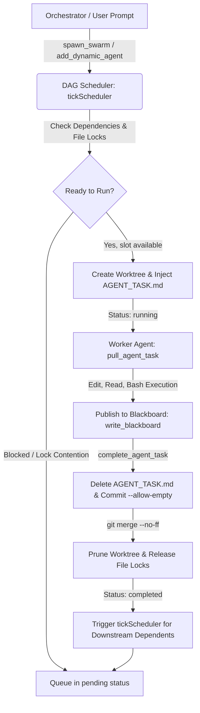

<div align="center">

# ⚡ Swarm Engine

### Autonomous Multi-Agent Orchestration Engine & MCP Server with Live Fable TUI Dashboard

[](LICENSE)
[](test/)
[](https://www.typescriptlang.org/)
[](https://nodejs.org)
[](https://modelcontextprotocol.io)
[](package.json)

<p align="center">
  <b>Swarm Engine</b> turns any single AI coding assistant into a coordinated team of autonomous agents. It provisions isolated Git worktrees, prevents merge collisions via atomic file locking, schedules tasks through a Directed Acyclic Graph (DAG), coordinates shared memory via a real-time blackboard, and streams live telemetry to an interactive Fable 5.1 terminal dashboard.
</p>

</div>

---

## 🌟 Key Highlights

- 🤖 **Works with Any Model**: Seamlessly orchestrate Claude 3.5 Sonnet, GPT-4o, Gemini 1.5 Pro, or local offline LLMs via Ollama (`qwen2.5-coder`, `llama3.2`, `deepseek-coder`). Models dynamically display what you configure.
- 🎨 **Fable 5.1 Live TUI Dashboard**: Real-time terminal interface with 2-column rounded cards, solid red/green diff bars with line numbers, active tool dispatches, live token throughput (`tok/s`), and task status.
- 🛡️ **Zero Git Collisions**: Each subagent executes in an isolated `git worktree` (`.swarm/worktrees/<agentId>`) on dedicated branches (`swarm/<agentId>`).
- 🔒 **Atomic Filesystem Locking**: Cross-platform file mutual exclusion (`state.json.lock`) with automatic stale lock recovery (>30s or dead PID).
- 🧩 **Universal MCP Server**: Seamlessly plug into **Kilo Code**, **Cursor**, **Claude Desktop**, **Cline**, **Roo Code**, or any Model Context Protocol host via standard I/O.
- 🧠 **Shared Blackboard Memory**: Real-time key-value store for passing database schemas, API contracts, and architectural decisions between sibling agents.
- 🚀 **Zero-Bloat Native Core**: Powered exclusively by `@modelcontextprotocol/sdk` and `zod`, relying on native Node.js primitives for all cryptographic, process, and filesystem operations.

---

## 🖥️ Live Fable Dashboard Preview

When running `swarm-engine run` or `swarm-engine watch`, Swarm Engine renders an interactive terminal dashboard matching the Fable 5.1 aesthetic:

```text
swarm-engine -> 3 × workers · ~/my-app                                            ↓ 242.0k · 12m 45s
* swarm   lead orchestrator                                                workers : gpt-4o : claude-3-5
● Final pass. Dispatching.
● Mission: Multi-agent service refactoring and API migration
● @worker-1 Fix lint errors and refactor codebase.
◒ Orchestrating... (12m 45s · 242.0k tokens · esc to interrupt)
────────────────────────────────────────────────────────────────────────────────────────────────────────
╭ * worker-1 ──────────────── refactor_specialist · gpt-4o ╮ ╭ * worker-2 ─────────────────── test_engineer ╮
│ ● Edit(src/services/auth.ts)                             │ │ ● Read(tests/auth.test.ts)                   │
│  140 - let reps = 0                                      │ │   └ Read 94 lines                            │
│   68 + const reps = 0                                    │ │ ● Bash(npm test auth)                        │
│ ● Refactoring... (↓ 92.0k · 78 tok/s)                    │ │ ● Testing... (↓ 124.0k · 110 tok/s)          │
╰──────────────────────────────────────────────────────────╯ ╰──────────────────────────────────────────────╯
╭ * worker-3 ────────────────────────────── cleanup_agent ╮
│ ● Read(src/ui/Component.tsx)                             │
│   └ Read 160 lines                                       │
│ ● Simmering... (↓ 26.0k · 44 tok/s)                      │
╰──────────────────────────────────────────────────────────╯
[swarm-engine] 0:agents* 1:orchestrator ● 1/3 done · +142 -38 lines · 1 active lock       q: quit  r: refresh
```

---

## 🚀 Quick Start & Installation

### Option 1: Global CLI Installation (Recommended)

Install globally so the `swarm-engine` command is available everywhere in your terminal:

```bash
npm install -g swarm-engine
```

### Option 2: Local Development from Source

If you cloned or are contributing to Swarm Engine:

```bash
git clone https://github.com/PRIYAGDEV/swarm-engine.git
cd Swarm-engine

# Install dependencies and build TypeScript
npm install
npm run build

# Link CLI executable globally to your system
npm link

# Run automated tests (56/56 passing)
npm test
```

### Option 3: Run On-Demand with `npx`

```bash
npx swarm-engine init "Refactor architecture and write unit tests" --concurrency 4
```

---

## 📖 CLI Usage & Commands

```bash
# 1. Initialize a swarm in your project workspace
swarm-engine init "Refactor payment processing and decompose services" --concurrency 4

# 2. Launch autonomous execution with the live Fable TUI dashboard
swarm-engine run "Refactor payment processing and decompose services"

# 3. Open the live auto-refreshing dashboard in any terminal window
swarm-engine watch

# 4. View swarm status once (plain table for CI, or formatted Fable cards)
swarm-engine status
swarm-engine status --table
swarm-engine status --json

# 5. Cleanly reset all worktrees, branches, and state
swarm-engine reset --hard
```

### Complete CLI Command Reference

| Subcommand | Description | Key Options |
|:---|:---|:---|
| `init [mission]` | Initializes `.swarm/`, creates `AGENTS.md`, and updates `.gitignore` | `--concurrency <num>`, `--model <name>`, `--worker <cmd>`, `-f` |
| `run [mission]` | Schedules agents and launches autonomous execution with live TUI | `--concurrency <num>`, `--model <name>`, `-f` |
| `start [mission]`| Alias for `run` | Same as `run` |
| `watch` | Auto-refreshing interactive Fable TUI dashboard | `--interval <ms>` (default: 2000), `--once` |
| `dashboard` / `tui` | Aliases for `watch` | Same as `watch` |
| `status` | Snapshot display of mission, agents, locks, and progress | `--table` (CI mode), `--json` (machine output) |
| `worker <id>` | Executes autonomous task runner inside an agent's worktree | `--cwd <path>` |
| `complete <id>` | Commits worktree changes, merges to main, and unblocks dependents | `[summary]` |
| `reset` | Prunes worktrees, deletes swarm git branches, and clears locks | `--hard`, `--keep-blackboard` |
| `mcp` | Launches the Model Context Protocol stdio JSON-RPC server | N/A |

---

## 🧠 Use as an Agent Skill (Recommended: Zero Configuration — Skip MCP!)

You don't need to configure MCP JSON files or manage background stdio servers! Swarm Engine is packaged as a first-class **Agent Skill** ([`skills/swarm-engine/SKILL.md`](skills/swarm-engine/SKILL.md)).

AI coding assistants (**Antigravity**, **Kilo Code**, **Claude Code**, **Cursor**, **Cline**, **Roo Code**) can drive Swarm Engine directly through terminal tool calls:

```bash
# 1. Initialize swarm in any workspace
swarm-engine init "Refactor architecture and write unit tests" --concurrency 4

# 2. Launch autonomous execution with live visual cards (auto-detects models!)
swarm-engine run "Refactor architecture and write unit tests"

# 3. Check real-time progress
swarm-engine status
swarm-engine status --table
swarm-engine status --json
```

#### How to Install the Skill:
- **Global User Skills**: Copy the `skills/swarm-engine` folder into your agent's skills directory (e.g. `~/.gemini/config/skills/swarm-engine`).
- **Workspace Skill**: Keep `skills/swarm-engine/SKILL.md` directly inside your project repository.

---

## 🔌 Optional: Connecting via MCP (Model Context Protocol)

Swarm Engine implements the official **Model Context Protocol (MCP)** specification. Connect it to your preferred AI coding assistant:

### 1. Kilo Code, Cline & Roo Code
Add to `cline_mcp_settings.json` (or your extension's MCP configuration):

```json
{
  "mcpServers": {
    "swarm-engine": {
      "command": "swarm-engine",
      "args": ["mcp"]
    }
  }
}
```
*Note: If running from local source, set `"command": "node"` and `"args": ["/absolute/path/to/Swarm-engine/dist/index.js", "mcp"]`.*

### 2. Cursor
Add to `.cursor/mcp.json` (or **Settings > Features > MCP**):

```json
{
  "mcpServers": {
    "swarm-engine": {
      "command": "swarm-engine",
      "args": ["mcp"]
    }
  }
}
```

### 3. Claude Desktop
Add to `claude_desktop_config.json`:
- **Windows**: `%APPDATA%\Claude\claude_desktop_config.json`
- **macOS**: `~/Library/Application Support/Claude/claude_desktop_config.json`

```json
{
  "mcpServers": {
    "swarm-engine": {
      "command": "swarm-engine",
      "args": ["mcp"]
    }
  }
}
```

---

## 🛠️ MCP Tools Reference

When connected to any MCP client, Swarm Engine exposes 9 core tools:

| MCP Tool | Description | Input Parameters | Return Value |
|:---|:---|:---|:---|
| `spawn_swarm` | Initializes or reconfigures a multi-agent mission, validates DAG dependencies, and schedules initial agents. | `mission`, `maxConcurrency`, `agents`, `workerCommand` | Snapshot with active locks and status dashboard |
| `add_dynamic_agent` | Adds a specialist agent mid-execution; automatically queues or schedules based on file locks and dependencies. | `role`, `taskSpec`, `model`, `dependsOn`, `targetFiles` | `{ success, agent, scheduled, reason }` |
| `pull_agent_task` | Claims or inspects the next ready task, returning worktree directory, prompt, and blackboard memory. | `agentId` (optional) | `{ agentId, role, worktreePath, taskSpec, blackboard }` |
| `record_agent_action` | Streams live tool operations (`Edit`, `Read`, `Bash`) and diffs into the live Fable dashboard. | `agentId`, `actionType`, `target`, `diffs`, `detail` | `{ success, agentId, actionType }` |
| `update_agent_progress`| Updates agent thoughts, poetic verbs (*Pruning*, *Simmering*), token counts, and `tok/s` speed. | `agentId`, `thought`, `verb`, `tokens`, `tokPerSec` | `{ success, agentId }` |
| `run_agent_task` | Triggers autonomous background worker execution inside the agent's worktree. | `agentId` | `{ success, started, agentId }` |
| `write_blackboard` | Publishes shared variables, schemas, or API contracts accessible by all swarm agents. | `key`, `value` | `{ success, key, allKeys }` |
| `complete_agent_task` | Commits changes, merges worktree cleanly to main (`--no-ff`), releases locks, and unblocks dependents. | `agentId`, `summary` | `{ success, agentId, unblockedAgents }` |
| `get_swarm_status` | Returns a complete real-time snapshot of mission, agents, active file locks, and blackboard state. | `detail` (boolean) | Snapshot JSON and formatted Fable card dashboard |

---

## 🔄 Multi-Agent Lifecycle & Architecture



1. **Mission Initialization (`spawn_swarm`)**: The orchestrator defines a mission and queues tasks with declared `targetFiles` and `dependsOn` arrays.
2. **DAG Scheduling (`tickScheduler`)**: The scheduler evaluates pending agents against available concurrency slots, dependency prerequisites, and file lock availability.
3. **Worktree Isolation (`createWorktree`)**: For each ready agent, an isolated Git worktree is provisioned with `AGENT_TASK.md` detailing the task, instructions, and shared blackboard state.
4. **Execution & Telemetry (`record_agent_action`)**: As the agent reads files, edits code, and executes bash tests, real-time diffs and token throughput are streamed live to the Fable dashboard.
5. **Memory Synchronization (`write_blackboard`)**: Agents publish shared data structures, interfaces, and flags to the blackboard for consumption by sibling agents.
6. **Task Completion & Merge (`complete_agent_task`)**:
   - `AGENT_TASK.md` is removed to prevent git history pollution.
   - Changes are committed and merged into the main branch cleanly (`--no-ff`).
   - Worktree and temporary branch are pruned.
   - File locks are released, and downstream dependents are unblocked immediately.

---

## 🛡️ The 4 Non-Negotiable Operational Safeguards

Swarm Engine guarantees absolute filesystem and process safety through four non-negotiable architectural safeguards:

| Safeguard | Name | Description & Enforcement |
|:---:|:---|:---|
| **S1** | **Stdio Isolation in MCP** | In MCP mode (`swarm-engine mcp`), standard output is reserved strictly for newline-delimited JSON-RPC frames. Zero `console.log` statements exist in MCP execution paths. All diagnostic messages route strictly to `stderr` to prevent protocol corruption. |
| **S2** | **Clean Git Merges & .gitignore** | `swarm-engine init` automatically appends `.swarm/` and `AGENT_TASK.md` to `.gitignore`. During `mergeAndComplete()`, `AGENT_TASK.md` is deleted before running `git add -A` so task prompt files never pollute git history. Merges handle empty diffs cleanly using `--allow-empty` commits. |
| **S3** | **Non-Git & Zero-Commit Fallback** | When operating outside a Git repository or in an unborn repo (0 commits / no HEAD), Swarm Engine automatically falls back to an atomic filesystem directory copy mechanism, preserving safety across non-git environments. |
| **S4** | **Normalized File Lock Paths** | All file paths in `targetFiles` and `lockedFiles` are automatically normalized (leading `./` removed, backslashes `\` converted to forward slashes `/`, duplicate slashes collapsed) to prevent lock collisions across Windows, macOS, and Linux. |

---

## 🧪 Comprehensive Test Suite (56/56 Passing)

Swarm Engine is verified by 56 automated end-to-end tests across 6 comprehensive tiers using the native Node.js test runner (`node:test`):

```bash
npm test
```

```text
✔ Tier 1 - MCP Tools in Isolation (7 tests)
✔ Tier 1 - CLI Subcommands in Isolation (5 tests)
✔ Tier 2 - Boundary & Corner Cases (8 tests)
✔ Tier 3 - Cross-Feature Interactions (6 tests)
✔ Tier 4 - Real-World Multi-Agent Workflows (3 tests)
✔ Tier 5 - Adversarial Coverage Hardening (16 tests)
✔ Tier 6 - Fable Multi-Agent Execution & Live Actions (4 tests)

ℹ tests 56 | pass 56 | fail 0 | cancelled 0 | skipped 0 (100% pass rate)
```

---

## 📄 License

This project is open-source software licensed under the **[MIT License](LICENSE)**.

Made with ⚡ by **[PRIYAGDEV](https://github.com/PRIYAGDEV)**. Contributions, issues, and feature requests are welcome!
